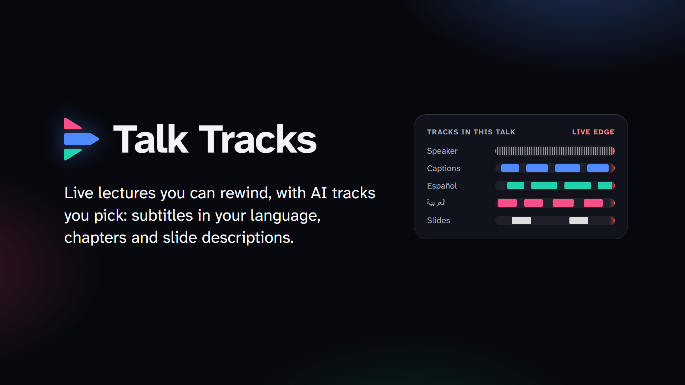
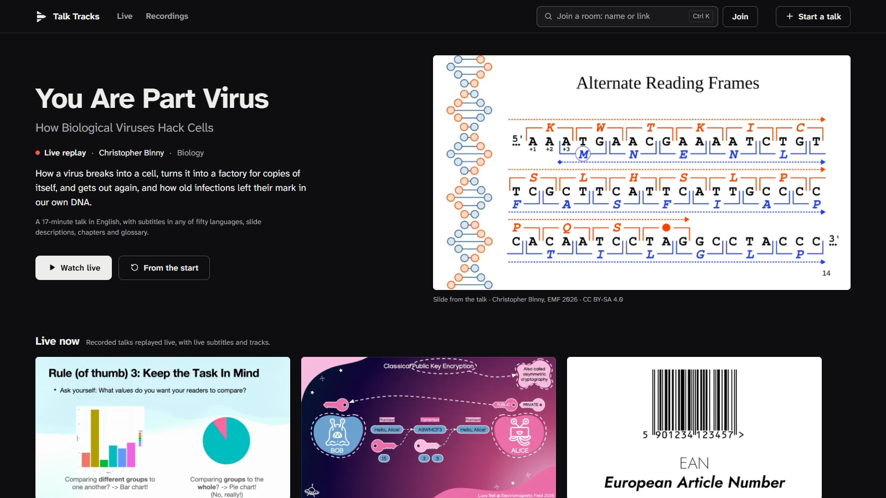
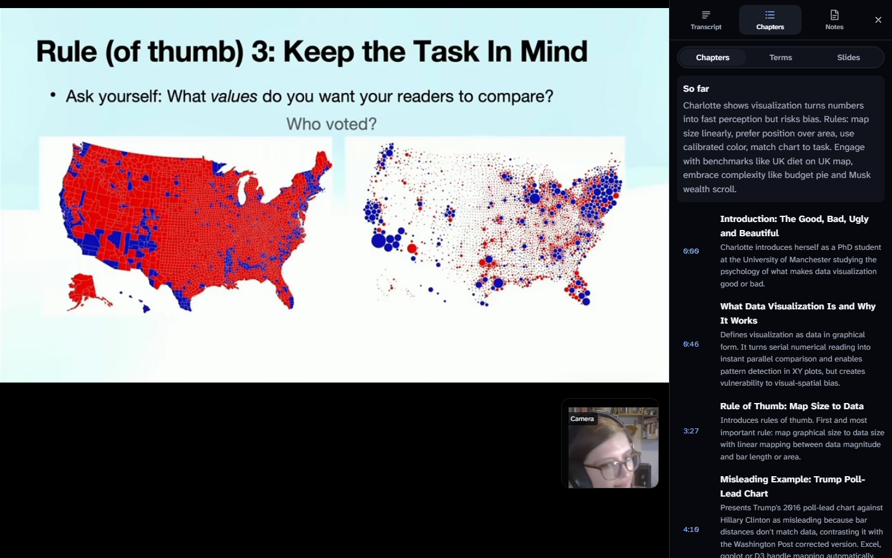
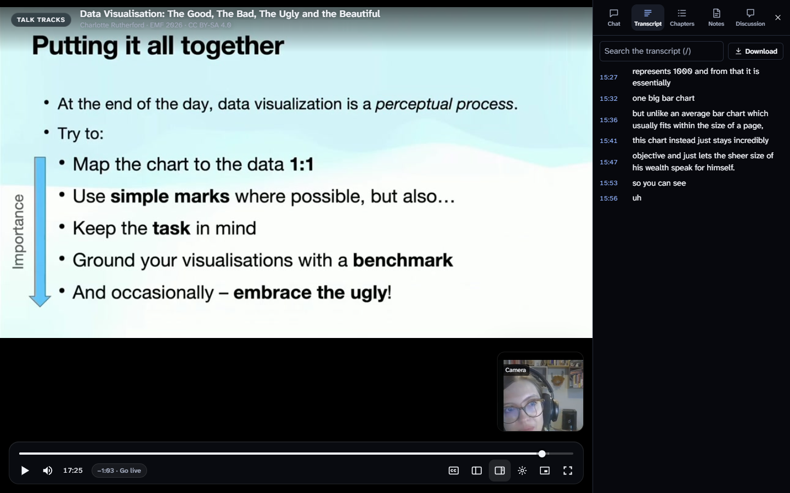
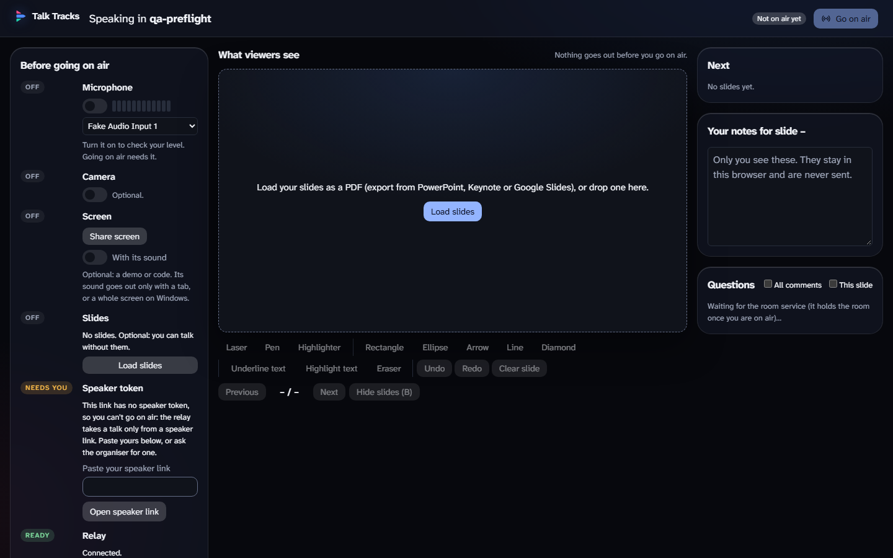
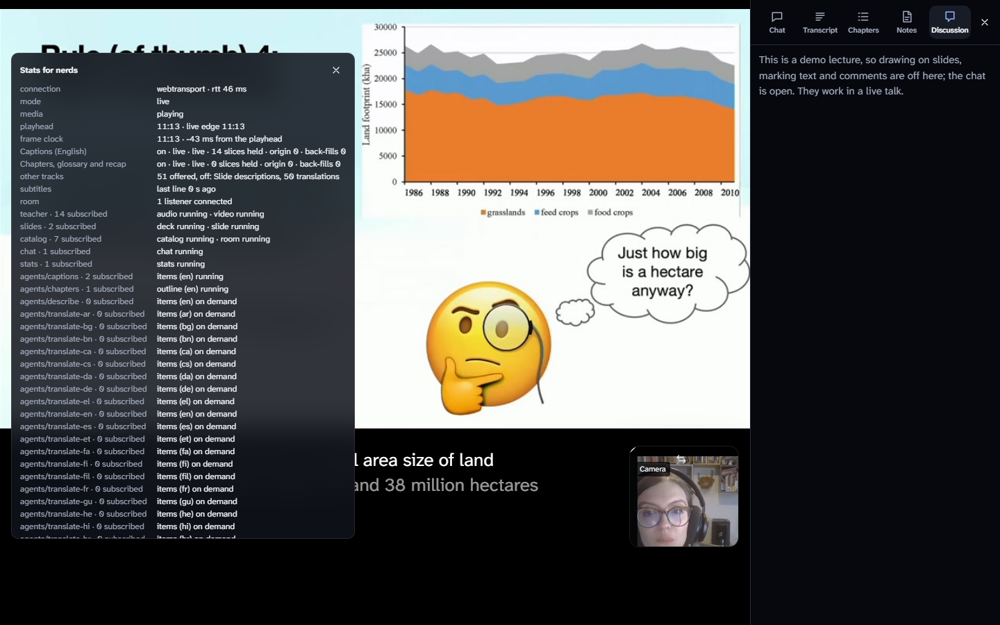
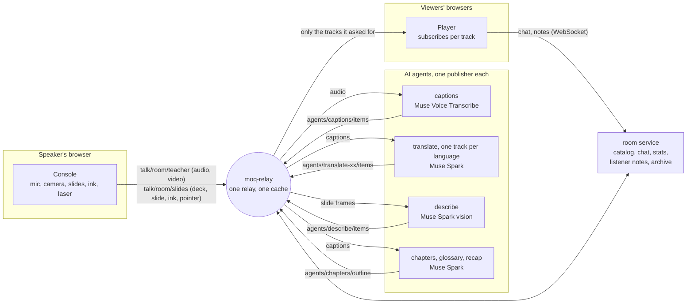

# Talk Tracks

AI agents that publish into a live talk over Media over QUIC.

**Live: [talk-tracks.leventaksakal.com](https://talk-tracks.leventaksakal.com)** · Built for the Meta Global AI
Developer Hackathon (Oct 26 – Nov 4, 2026) · Status: the submitted build, running live. Best in desktop Chrome or
Edge; Safari and older Firefox reach the relay over the WebSocket fallback.



## What it is

A speaker gives a talk from the browser, and the listeners watch it in a media player. Every AI job is its own
publisher of named tracks in the same live broadcast: captions, a translation per language, a description of each new
slide for a listener who cannot see it, and chapters with a glossary and a recap for someone who arrives late. A
viewer subscribes only to the tracks it wants, an agent runs only while someone watches its track, and the same
tracks serve rewind and the recording after the talk ends.

## Try it

Open [talk-tracks.leventaksakal.com](https://talk-tracks.leventaksakal.com) in desktop Chrome. Nothing needs an
account.

| What | Where | What to look at |
|---|---|---|
| **Live sessions** of four demo lectures | **Live now** row, or `/watch/virus`, `/watch/dataviz`, `/watch/rsa`, `/watch/qrcode` | Each session plays its lecture once from 00:00, ends, and a new session starts. Open the **CC** menu for captions or a translation into any listed language (each is made only once a viewer picks it), the side panel for chapters, glossary and transcript. Each slide's description is its text alternative for a screen reader, and the sound menu can read it aloud ("Speaker and slide descriptions"). On demo days the live AI tracks come from agents running on the session's audio in real time. |
| **Recordings** of the same lectures | **Recordings** row, or `/watch/virus-recording` and so on | The whole lecture, seekable from the start, with the speaker's camera in a tile beside the slides. Its captions, slide descriptions and chapters were made by the same agents and are labelled as recorded; a translation is made when you pick it, for the part you watch. |
| **Rewind** a live session | drag the progress bar back, or press J | The player leaves the live edge, shows what you missed, and **Go live** (G) returns. Slides, ink and subtitles replay at the time you seek to. |
| **Stats for nerds** | press I, or right-click the video | Every track of the room, its subscribers, which agents are running, and whether the connection is WebTransport or the WebSocket fallback. |
| **Offline demo** | `/demo` (and `/demo/rewind`) | The player on a scripted room, with no relay and no agents: useful when the network is bad. |
| **Start a talk** | **Start a talk** on the home page | Give a title, your name, a room name and an **access code**. You get a private speaker link for the console and an audience link to share. Judges: the access code is in the submission form, never in this repository. |
| **Speaker console** | the speaker link, `/talk/<room>?token=…` | Microphone check, camera, a PDF deck (rendered in the browser) or a shared screen, pen, highlighter, shapes and a laser pointer, then **Go on air**. Open the audience link in a second window to watch your own tracks arrive. |

**Seen on the live site, 2026-11-03** (headless, muted Chrome and page reads; no language was picked, as that costs
model calls):

- The home page answers 200 and lists **Live now** and **Recordings** rows for `virus`, `dataviz`, `rsa` and
  `qrcode`, each with *Watch live* and *From the start*. `/watch/<id>`, `/watch/<id>-recording`, `/demo` and
  `/demo/rewind` all answer 200.
- `/watch/virus` shows the badge "LIVE · session from a recording", the chat, transcript, chapters, notes and
  discussion tabs. `/watch/virus-recording` shows the badge "Recording", with transcript, chapters and notes and no
  chat. `/demo` shows the "Offline demo" badge and a scripted transcript.
- The shipped app contains the CC menu's *Search any language*, the sound menu's *Speaker and slide descriptions*,
  *Go live*, *You missed*, *Stats for nerds*, *Start a talk* and the access-code field.
- Not seen headless: the restart of a live session at 00:00, the drag-to-rewind itself and the speaker console. These
  rest on the earlier muted end-to-end runs below. The home page's lecture cards still list four languages as
  examples; any of the 50 can be picked.

**Measured (muted end-to-end runs, decision 0035).** No translation exists until a viewer picks a language, and any of
the 50 in [`contracts/languages.json`](contracts/languages.json) can be picked (Meta publishes no list, so the list is
marked unconfirmed). Live: the first Japanese subtitle came 7.2 s after picking it. Recording, German: 0.4 s at the
start and 0.4 s after a seek once that part had been made; 20.5 s for a part not yet made, right after a seek. A pick
costs about $0.0006 to $0.007 in a recording and about $0.025 for a live minute or so.

Player keys: Space or K play/pause, J/L 10 s back/forward, G go live, C subtitles, S side panel, F or double-click
fullscreen, M mute, I stats, ? every shortcut.

## Screenshots

<!--
  Placeholders: the coordinator adds the final screenshots from the QA run under docs/screenshots/ (file names and
  what each shows are in docs/screenshots/README.md), then removes this comment and the line below it.






-->

_Screenshots of the final build are added after the QA run; until then the title card above shows the idea._

## How it works



- **One broadcast per publisher.** The speaker, each agent and the room service each publish their own named tracks
  under `talk/<room>/…`. An agent can be added, swapped or restarted mid-talk; a restarted one resumes from its own
  track history, and the agents downstream follow the new instance without restarting.
- **Tracks are opt-in and lazy.** A viewer subscribes per track. The relay merges duplicate subscriptions, so an
  agent sees when nobody watches its track and spends nothing until someone does.
- **Live and past on one track.** Each AI track is a timeline of 4 s slices. A viewer subscribes to the live edge
  and fetches earlier slices of the same track by MoQ FETCH; the relay caches them, so the second viewer to rewind
  costs no model call.
- **A relay limit we hit.** moq-relay advertises every namespace it knows to each agent connection, and each
  advertisement holds one bidirectional stream. The 52 lazy language tracks per room used up aiopquic's default 512
  streams, and the relay's SUBSCRIBE and FETCH then waited forever. Granting 16384 (`TT_MOQ_MAX_STREAMS_BIDI`) fixed it;
  see [deploy](wiki/howto/deploy.md).
- **Recording plus live session.** Every room is archived as it plays (CMAF segments with HLS playlists, and the
  agents' slices). An ended talk plays back from that archive in the same player, built on Media Chrome.
- **Honest, capped AI.** Live AI tracks come from agents hearing the live audio, never from a replay. Every model
  call goes through one spend ledger with a cap per room and a ceiling for the whole deployment.

More: [the track system](wiki/design/moq-track-system.md), [decisions](wiki/decisions/), and
[a benchmark against LL-HLS and WebRTC](wiki/benchmark.md).

## Meta models used

| Job | Model | What it does |
|---|---|---|
| Live captions | Muse Voice Transcribe (`muse-voice-transcribe-1.0`), realtime endpointing | Turns the speaker's audio into caption lines as they speak. It is the source text for every other AI track. |
| Translation | Muse Spark (`muse-spark-1.3`, Standard mode) | Translates each caption line into any listed language a viewer picks, made only while someone watches it, with the three lines before it as context. |
| Slide description | Muse Spark, vision input | Describes each new slide for a listener who cannot see it; a slide shown again reuses its description. |
| Chapters, glossary, recap | Muse Spark | Splits the talk into chapters as it goes, explains the technical terms in a glossary, and writes a recap for late joiners. |
| Punctuation of recordings | Muse Spark | Adds sentence and clause marks to a recording's caption lines without changing a word, so subtitles break on sentences. |

## Run it locally

Needs Docker, Node 24 and (for the Python checks) Python 3.13 with [uv](https://docs.astral.sh/uv/). Fake mode uses
scripted speech recognition and a fake model: no Meta API key, no cost.

```bash
# A relay and every agent, in fake mode, plus a stand-in speaker (a looping tone in room "dev")
docker compose -f deploy/compose.local.yml up -d --build
docker compose -f deploy/compose.local.yml --profile dev up -d teacher

# The web app
cd web
npm ci
npm run dev                      # http://localhost:5173
```

Open `http://localhost:5173/watch/dev` for the viewer, `/talk/<room>` for the speaker console (stop the `teacher`
container first if you speak in room `dev`), or `/demo` for the offline player. To run one agent against the Meta
API, pass your key from the environment (`-e META_API_KEY`), never in a file; see
[run-locally](wiki/howto/run-locally.md), [web](wiki/howto/web.md) and [deploy](wiki/howto/deploy.md).

Checks: from `agents/`, `uv run ruff check .`, `uv run pyright`, `uv run pytest -q`; from `web/`, `npm run typecheck`,
`npm run lint`, `npm test`. Enable the pre-commit hook with `git config core.hooksPath .githooks`.

## Layout

| Path | What |
| --- | --- |
| `agents/` | Python agents (captions, translate, describe, chapters), the room service and archive, the Meta providers, tests |
| `web/` | Speaker console and viewer: React 19 + TypeScript, Media Chrome for the player, Astryx components |
| `deploy/` | Relay, auth, web server, demo sessions, recordings and agents on a single VM (Docker Compose) |
| `contracts/` | JSON Schemas of every payload, generated from the Python models |
| `bench/` | The latency benchmark against LL-HLS and WebRTC (its fan-out table is not reproduced) |
| `qa/` | Journey screenshots, Lighthouse and performance traces |
| `wiki/` | Product, specs, how-tos and decision records ([index](wiki/README.md)) |
| `tickets/` | Questions for the owner, with their answers |

## Built during the hackathon

Everything in this repository was written from 2026-10-27 on, in the hackathon's building period (first commit
2026-10-27). Before the event the author ran feasibility measurements (relay choice, browser and phone behaviour,
load) and kept notes; no code from before the event is in this repository.

Built here: the agents and their track formats, the room service, archive, spend ledger and access codes, the speaker
console, the viewer and its tracks, rewind, the demo sessions and recordings, the benchmark and the QA harness.
Not built here, and used under their licences ([NOTICE](NOTICE)): the relay (moq-relay), the browser MoQ libraries
(`@moq/*`), the player's controls (Media Chrome), hls.js, PDF.js, perfect-freehand, aiomoqt, PyAV, the fonts, and the
demo lectures below.

## Demo lectures

The demo rooms play four talks from Electromagnetic Field 2026, recorded by the EMF Video Team and C3VOC and
published on media.ccc.de under [CC BY-SA 4.0](https://creativecommons.org/licenses/by-sa/4.0/):

| Room | Talk | Speaker | Part used |
| --- | --- | --- | --- |
| `virus` | [You Are Part Virus: How Biological Viruses Hack Cells](https://media.ccc.de/v/emf2026-149-1-you-are-part-virus-how-biological-viruses-hack-cells) | Christopher Binny | 0:12.6–17:12.8 of the recording |
| `dataviz` | [Data Visualisation: The Good, The Bad, The Ugly and the Beautiful](https://media.ccc.de/v/emf2026-241-1-data-visualisation-the-good-the-bad-the-ugly) | Charlotte Rutherford | 0:12.6–19:11.4, the whole talk |
| `rsa` | [It's the End of RSA as We Know It (And I Feel Fine): An Introduction to Post-Quantum Cryptography](https://media.ccc.de/v/emf2026-242-1-its-the-end-of-rsa-as-we-know-it-and-i-feel-fine) | Lucy Bell | 0:12.6–20:04.8 of the recording |
| `qrcode` | [A Brief History of the QR Code, and other scannable things](https://media.ccc.de/v/emf2026-234-1-a-brief-history-of-the-qr-code-and-other-scannable-things) | Jon Ginn | 0:12.6–16:22.4, the whole talk |

Changes made:

- Each talk is trimmed: the EMF title card, sponsor logos and jingle at the start are cut, and so is the closing
  licence card. The biology and RSA talks end at section breaks before the concluding Q&A or final parts; the design
  and QR code talks are used whole.
- Each is re-encoded for streaming (720p H.264, mono Opus).
- AI-generated tracks are added by this project's agents with Meta models: captions, slide descriptions, and
  chapters with a glossary and recap, and translations made on demand. The recordings carry tracks made once (their
  translations are made when a viewer picks a language); the live sessions get theirs from the live agents.

The trimmed videos and the tracks derived from them are shared under CC BY-SA 4.0 too. The cuts are in
`deploy/media/demo-lectures.sh`. The videos themselves are not in this repository.

## Licence

Apache-2.0, see [LICENSE](LICENSE). Third-party software, fonts and media, with their licences, are listed in
[NOTICE](NOTICE). The demo lectures and their derived tracks are CC BY-SA 4.0 (see above).
