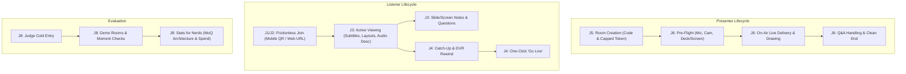

# Talk Tracks: Core User Journeys

**Status:** approved draft · **Date:** 2026-10-31 · **Decisions incorporated:** 0017–0023, Ticket 0020, and Presenter decisions (optional deck, screen share with canvas/laser overlay, unified console, Cloudflare Access).

---

## 1. Security & Pre-Submission Access Boundary

> [!IMPORTANT]
> **Cloudflare Access (CF_ACCESS) Guardrail**
> To prevent web crawlers, search indexers, and unauthorized discovery before hackathon submission:
> - The web application and public endpoints are placed behind **Cloudflare Access** with **Google IdP**.
> - Access is restricted strictly to an email whitelist (team & designated judges).
> - Public WebSocket and WebTransport endpoints authenticate through signed tokens (Decision 0005) or the Access tunnel.

---

## 2. Core User Journeys

---

### J1 · Listener Arrives via Mobile (Projected QR)

> **As a lecture attendee on my phone,**  
> I want to scan a projected QR code from my seat and enter the talk immediately without logging in or downloading an app,  
> **So that** I can hear the speaker and see real-time subtitles in my language with zero setup.

* **Entry point:** Native phone camera scanning the presenter's projected QR code (`https://<host>/watch/<room>`).
* **Steps:**
  1. Opens URL in mobile browser (Safari iOS / Chrome Android).
  2. First tap unlocks audio (standard browser autoplay policy).
  3. Video/slide layout adapts responsively to portrait (16:9 player on top, chapters and controls thumb-accessible below).
  4. Taps **CC** button to pick subtitle language (e.g., Español, Arabic with RTL text direction).
* **Edge & Failure cases:**
  - *iOS Safari:* Automatically uses the HTTP/WebSocket fallback with steady ~3s latency indicator.
  - *Speaker not started:* Shows friendly "Starting soon when speaker goes on air" status without disconnecting.
* **Acceptance Criteria:**
  - [ ] Time from QR scan to first live audio frame is < 2.5s on WebTransport (< 4s on WebSocket).
  - [ ] CC language picker renders language names in their native script (`Intl.DisplayNames`).
  - [ ] Touch targets are at least 44×44 px.

---

### J2 · Listener Arrives via Desktop (Web Lobby)

> **As a remote student or attendee on desktop,**  
> I want to open the site, select a demo lecture or type a room code,  
> **So that** I can immediately watch with full dual-source layout options.

* **Entry point:** Desktop browser navigating to `https://<host>/`.
* **Steps:**
  1. Authenticates through Google IdP via Cloudflare Access.
  2. Lands on the Lobby: views cards for 4 CC BY-SA 4.0 demo lectures (`virus`, `dataviz`, `rsa`, `qrcode`) or enters room slug.
  3. Enters `/watch/<room>`: connected to MoQ relay, subscribes to speaker audio/video and active slide/screen track.
* **Acceptance Criteria:**
  - [ ] Lobby loads cleanly with no layout shift (CLS < 0.1).
  - [ ] Switching to `/watch/<room>` preserves audio/video playback state.

---

### J3 · Listener Active Engagement & Side-Panel Interaction

> **As an engaged listener,**  
> I want to switch viewing layouts, take personal notes, and anchor questions to slides,  
> **So that** I retain key lecture points without interrupting the speaker.

* **Capabilities:**
  - **Layout switcher (⧉):** Single, Split (side-by-side with draggable split), or Picture-in-Picture.
  - **Side Panel (☰):**
    - *Transcript tab:* Live autoscrolling transcript with clickable timestamps and search (`/`).
    - *Chapters tab:* YouTube-style segments with thumbnail previews and live-updated recap summaries.
    - *Glossary tab:* AI-extracted technical terms with definitions and first-mention jump links.
    - *Notes tab:* Bookmark timestamp (`B`), type private notes, export to Markdown.
  - **Slide & Screen Annotations (Ticket 0020):**
    - Audience text marks (underline and highlight) and pencil notes on slides.
    - Shared track per kind (`talk/R/annotations/{ink,marks}`) routed through the room service.
* **Acceptance Criteria:**
  - [ ] Toggling layout maintains synchronized canvas overlay alignment.
  - [ ] Marking text or drawing creates records stamped with author attribution `by: {id, name}`.

---

### J4 · Late Joiner & Catch-up (DVR Rewind)

> **As someone who joined 15 minutes late or had a temporary network drop,**  
> I want to rewind the talk and read an AI-generated recap of what I missed,  
> **So that** I can catch up on foundational concepts and jump back to live when ready.

* **Steps:**
  1. Scrub progress bar backwards or click an earlier chapter thumbnail.
  2. Player transitions from `● LIVE` (red) to `−12:30` (grey offset).
  3. Video/audio fetches historical slices from the VM archive; slides, ink, text marks, and laser positions replay identically at that exact historical room time $t$.
  4. Banner prompts: *"You missed 12:30 · 2 chapters [Catch up Recap] [Jump to Live]"*.
  5. Clicking **Go Live** (`G`) glides playhead back to real-time broadcast.
* **Acceptance Criteria:**
  - [ ] Seeking reads group $\lfloor t / 4\text{s} \rfloor$ keyframe carry-in (Object 0) without loading earlier slices.
  - [ ] Historical speaker and audience drawings render at historical room clock $t$.
  - [ ] Clicking `● LIVE` resumes real-time broadcast with no desync.

---

### J5 · Presenter Room Creation & Setup

> **As a Presenter / Teacher,**  
> I want to create a talk room with a title and access code,  
> **So that** I get an authorized speaker URL with an allocated spend budget and an audience invitation link.

* **Entry point:** Lobby "Create Talk" modal or direct API.
* **Steps:**
  1. Enters Talk Title (e.g., "Intro to Quantum Cryptography"), Room slug (`quantum-101`), and Presenter Passcode.
  2. Backend room service validates code, initializes room catalog (`talk/quantum-101/catalog`), and mints a capped publishing token (e.g., $2.00 room cap).
  3. Displays:
     - **Speaker Console URL** (with private JWT token): `/talk/quantum-101?token=...`
     - **Audience URL & Projector QR Code**: `/watch/quantum-101`
  4. Clicks "Enter Pre-Flight".
* **Acceptance Criteria:**
  - [ ] Token is signed with VM's `private.jwk` and restricted to `talk/quantum-101/**`.
  - [ ] Room record registers spend cap in `$TT_DATA/caps/`.

---

### J6 · Presenter Delivery: Unified Console with Screen Share & Slide Overlays

> **As a Presenter,**  
> I want a unified console supporting camera, screen share, and optional slide deck with real-time drawing and laser pointer across both slides AND shared screen,  
> **So that** I can teach fluidly using whatever visual media I prefer, with full interactive annotations.

* **Pre-Flight Checks (Staging):**
  - Microphone live VU level test ("Say something to test mic").
  - Camera preview toggle (On/Off).
  - Visual source selection:
    - **Camera only** (no deck needed)
    - **Camera + Whiteboard Canvas**
    - **Camera + PDF Slide Deck** (drag-and-drop PDF rendered in-browser via PDF.js)
    - **Screen Share** (`getDisplayMedia` window/screen capture)
  - Unified Presenter View: current view, next slide thumbnail (if deck present), and private notes.
  - Big green button: **Go On Air**.
* **On-Air Delivery:**
  - Room status emits `on_air` on `talk/R/catalog`.
  - Interactive Toolbar (Excalidraw UX):
    - Pen (smoothing via `perfect-freehand`)
    - Marker (highlighter with fixed opacity)
    - Basic Shapes: Rectangle, Ellipse, Arrow, Line
    - Eraser (element sweep)
    - Laser Pointer with fading trail
    - Undo / Redo (`Ctrl+Z`, `Ctrl+Y`)
  - **Overlay on Screen Share:** Presenter can draw shapes, highlight, and point the laser directly over the live screen share canvas as well as slides!
  - Audience Question Drawer: displays slide/screen-anchored questions without modal popups.
* **End Talk:**
  - Presenter clicks **End Talk** (requires 1-click confirmation).
  - Emits `room: ended`; spins down live AI agents to prevent further spend; generates permanent replay URL.
* **Acceptance Criteria:**
  - [ ] Drawing shapes and laser pointer works seamlessly over both PDF slides and screen share video.
  - [ ] Drawing emits MSF event records (`InkStroke`, `InkPoints`, `shape`, `PointerObject`) on the room clock.
  - [ ] Speaker's private notes never leak to relay or viewers.

---

### J7 · Post-Session Student Replay

> **As a student reviewing the lecture after class,**  
> I want to open the room URL of an ended talk,  
> **So that** I can review the entire talk with video, slides, screen share, drawings, and AI transcript preserved in sync.

* **Acceptance Criteria:**
  - [ ] `/watch/<room>` indicates "Recorded Session" with total duration.
  - [ ] Seeking to any minute replays the exact drawings, slide changes, and subtitles as delivered live.

---

### J8 · Hackathon Judge / Evaluator Journey

> **As a hackathon judge evaluating Talk Tracks,**  
> I want to immediately grasp the MoQ architecture, test the 4 demo moments, and verify live spend ceilings,  
> **So that** I can evaluate innovation, technical execution, and user experience within 3 minutes.

* **Steps:**
  1. Opens site behind Cloudflare Access (using judge credentials).
  2. Sees 4 CC BY-SA 4.0 EMF 2026 demo lectures looping with full 6-track AI generation.
  3. Tests **Four Architecture Moments** ([demo-moments.md](../howto/demo-moments.md)):
     - *Moment 1:* Instant track opt-in (subscribing to Arabic causes zero disruption to video).
     - *Moment 2:* MoQ Relay cache hit (seeking back loads from relay cache with 0ms LLM spend).
     - *Moment 3:* Hard spend ceiling & agent failover.
     - *Moment 4:* Replay of interactive ink and slide descriptions.
  4. Opens **Stats for Nerds** overlay: inspects active MoQ tracks, WebTransport vs WebSocket fallback, relay cache hit ratio, and live ledger spend ($4.65 spent against $100 cap).
* **Acceptance Criteria:**
  - [ ] Stats for Nerds overlay displays live track subscriptions and spend ledger accurately.
  - [ ] Demo room loops reset cleanly without broken subscriptions.

---

## 3. Screen & State Inventory

| Screen | URL | Primary State / Elements |
|---|---|---|
| **Lobby** | `/` | Hero value prop, 4 demo lecture cards with live badge, Room Join/Create input, How-it-works summary |
| **Viewer (Player)** | `/watch/:room` | Media canvas (Cam/Slides/Screen), Draggable Subtitle overlay, Ink overlay, Chapter progress bar, Control bar, Collapsible Side Panel (Transcript, Chapters, Glossary, Notes) |
| **Speaker Console** | `/talk/:room?token=...` | Pre-flight checklist, Unified Presenter View, Drawing Toolbar (Pen, Marker, Shapes, Laser, Eraser, Undo), Live on-air timer, Question drawer |
| **Ended / Replay** | `/watch/:room` | Complete seekable recording player, session recap summary, note export |
| **Not Found / Error** | `/*` | Friendly route error, relay disconnect recovery prompt |

---

## 4. 3-Minute Demo Video Golden Path

1. **0:00 – 0:30 (The Hook & Concept):** Lobby overview; explain Talk Tracks core concept: "A speaker talks, and AI agents publish live tracks over Media over QUIC."
2. **0:30 – 1:15 (The Listener & Multitrack Power):** Jump into demo room `dataviz`; switch subtitles to Arabic; inspect real-time glossary; scrub back 5 minutes to show instant DVR replay with synchronized drawings.
3. **1:15 – 2:15 (The Presenter in Action):** Open `/talk/demo-live`; show unified console; share screen and PDF deck; use the laser pointer and draw shapes on both; show how audience sees it instantly.
4. **2:15 – 3:00 (Architecture & Judge Proof):** Pop up "Stats for Nerds"; show MoQ track fanout, WebTransport connection, lazy agent activation, and the $4.65 spend ledger against the $100 hackathon cap. End card.
