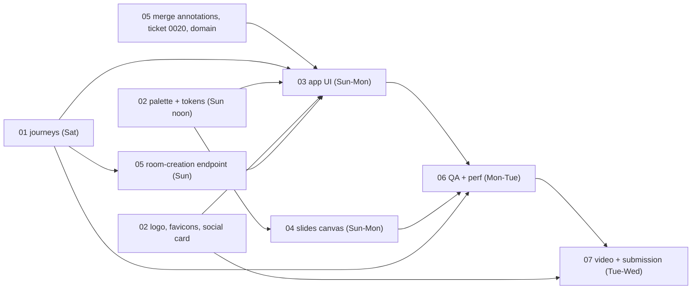

# Roadmap to submission (from 2026-10-31)

Replaces the dated tables in [plan.md](plan.md) from Sat Oct 31 on. Target: **submit by Wed Nov 4, 12:00 ET (20:00
+03)**; the hard deadline is 9 PM ET. `main` freezes **Tue Nov 3, 18:00 +03**.

## Where we are (2026-10-31 midday)

- **Merged:** agents on Muse models, relay with signed tokens, track archive and replay, four looped demo rooms
  with every AI track, contracts pass 2, the player (controls, chapters, captions, layouts, side panel, slides/ink/
  marks/laser live and in rewind), the speaker console (PDF.js deck, presenter view, pen, highlighter, text marks,
  laser, eraser, invite QR). Spend $4.65 of $100.
- **In flight:** audience annotations and comments (`lane/audience-annotations`, partly uncommitted); ticket 0020 open.
- **The product gap:** the parts that make it a product, not a smoke test, are missing or rough:
  - no **"create a room"** journey: a speaker needs a link minted on the VM by script;
  - the **lobby** is the smoke-test landing page;
  - no **brand**: one `favicon.svg`, no logo, palette, social card or banner;
  - the slide tools have **no shapes, no undo, no colour/width**, and no Excalidraw-grade feel;
  - **not tested** on Safari, iPhone or Firefox, and no performance pass.

> The infrastructure is built and runs on the VM, but "tested" is only partly true: cross-browser transport, agent
> kill-and-restart and a load pass are still open (workstream 05).

## Workstreams

Each workstream is one session you can pick up on its own. Briefs and logs: [workstreams/](workstreams/README.md).

| # | Workstream | What it delivers | Starts | Done by |
|---|---|---|---|---|
| 01 | [User journeys](workstreams/01-user-journeys.md) | The core journeys step by step with states and acceptance criteria | now | Sat 23:00 |
| 02 | [Brand and assets](workstreams/02-brand-and-assets.md) | Palette and tokens, type, logo, favicons, social card, banner, video title card | now | tokens Sun 13:00, assets Sun 22:00 |
| 03 | [App UI](workstreams/03-app-ui.md) | Lobby, create/join, room states, player and console design pass, built from 01 and 02 | Sat eve (shell), Sun (journeys) | Mon 18:00 |
| 04 | [Slides canvas and tools](workstreams/04-slides-canvas.md) | Excalidraw-style toolbar: shapes, pen, marker, eraser, laser, undo, colours, on the existing tracks | Sun 09:00 | Mon 18:00 |
| 05 | [Platform gaps and integration](workstreams/05-platform-gaps.md) | Merge annotations, room-creation endpoint, domain, deploys, restart and cross-browser transport checks | now | Mon 20:00 |
| 06 | [QA and performance](workstreams/06-qa-performance.md) | Chrome DevTools traces, Lighthouse, Core Web Vitals, visual verification, cross-browser | Mon 12:00 | Tue 16:00 |
| 07 | [Submission](workstreams/07-submission.md) | Demo video, submission text, README, credits, freeze | Tue 09:00 | Wed 12:00 ET |

## Order and dependencies

## Day by day (times +03)

| Day | Morning | Afternoon | Evening |
|---|---|---|---|
| **Sat Oct 31** | — | 05: commit and merge annotations, answer 0020, confirm the domain, deploy `main`. 01 and 02 sessions start. | 01 journeys reviewed and accepted. 02 palette shortlist. 03 starts the shell (routes, layout, lobby skeleton). |
| **Sun Nov 1** | 02 tokens land. 04 starts. 05 builds the room-creation endpoint. | 03 builds lobby, create room, join, room states. 02 logo and favicons. | 03 applies brand. 04 shapes and undo working on the console. Deploy. |
| **Mon Nov 2** | 03 player and console design pass. 04 replay of shapes in the player. | Merge 03 and 04, deploy. 06 starts: Lighthouse and traces, journey walk-throughs. Mint judge tokens. | 06 cross-browser, iPhone. Fix list triaged. |
| **Tue Nov 3** | 06 fixes, re-measure. 07 records the demo video. | 07 submission text, README, screenshots. | **18:00 freeze `main`.** Final deploy, final smoke. |
| **Wed Nov 4** | Buffer for fixes only. | **Submit by 20:00 +03 (12:00 ET).** | — |

## Cut order if Monday slips

1. Comments and the Discussion tab (keep audience ink and marks only if merged by Sun).
2. Shapes beyond rectangle and arrow (keep pen, marker, eraser, laser, undo).
3. Any-language translation (keep tr/es/ar).
4. Camera in the console.
5. Self-serve room creation falls back to links minted on the VM, shown as "Paste your speaker link".

## Status board

Every session updates its row and its own log.

| # | Status | Session | Last update | Blocker |
|---|---|---|---|---|
| 01 | in review | coordinator + owner | 10-31 13:25 | — |
| 02 | not started | — | — | — |
| 03 | not started | — | — | waits on 01 for journeys, 02 for tokens |
| 04 | not started | — | — | contract change via 05/coordinator |
| 05 | in progress | coordinator | 10-31 13:36 | hostname confirmed (stays DNS-only on the VM); annotations lane finishing |
| 06 | not started | — | — | waits on 03, 04 |
| 07 | not started | — | — | waits on 06 |
